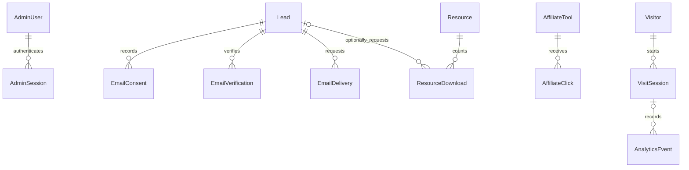

# NavoNixx architecture

## Application boundaries

App Router Server Components read public metadata and PostgreSQL content. Client Components are restricted to interactive search, tool processing, forms, consent, editors, tables, and charts. Sensitive tool text/results remain on the visitor's device. Regex execution happens in a worker with an execution deadline. Passwords and UUIDs use Web Crypto.

The static tool registry defines executable implementations. PostgreSQL `FreeTool` records configure titles, categories, SEO, enabled/featured states, and icons. A database record cannot create executable code. Original editorial content and source-linked AI listings are available before database setup and are imported by the idempotent seed; they do not replace persistent lead, analytics, auth, or admin data.

The design uses a shared navy/blue/lavender token palette, layered soft surfaces, locally hosted Geist, responsive grids, visible focus indicators, and reduced-motion-aware reveals. Charts load only within authenticated administration.

## Database relationships

Resources consolidate blog posts, prompt collections/items, templates, workflows, FAQs, and lead magnets using a validated kind. Their Markdown is rendered without raw HTML execution. Category strings are bounded metadata rather than separate lookup tables. Visit sessions consolidate attribution, device, and coarse country metadata. Typed events represent page views and tool usage; inputs/results are never event fields. Other tables cover contacts, campaigns, public settings, audit logs, and expiring rate limits.

Unique normalized emails prevent duplicate leads. Tokens and passwords are stored as hashes. Sessions have an eight-hour maximum lifetime; disabling an administrator or changing a password revokes server sessions. Foreign keys cascade consent/token/delivery data on lead deletion; anonymous resource-download records lose their optional lead relationship. Time/name/slug/path indexes support analytics filtering and aggregation. Traffic aggregation uses parameterized date-range SQL rather than client-side hardcoded statistics.

## Email and consent

1. Validate origin, limits, honeypot, bounded JSON, email, resource publication, and consent.
2. Upsert a normalized lead and append the consent choice in a transaction.
3. Persist a delivery record. Send the requested resource with a provider adapter.
4. If optional marketing is requested, issue a hashed expiring token and send a separate confirmation.
5. Confirm through an explicit POST; atomically claim the token before updating subscription status. Unsubscribe invalidates outstanding subscription tokens.

Resource delivery does not enroll the contact in marketing. Missing configuration records `NOT_CONFIGURED` and returns an honest message. A successful provider response records `ACCEPTED`, not an invented `DELIVERED`. Direct downloads remain available without email. Existing requests can be reviewed in Email Activity; a production mail queue/webhook/retry worker is a future operational enhancement.

## Analytics and privacy

Identification is opt-in, first-party, and cookie-based. Events are batched, bounded, whitelisted, and deduplicated by UUID. The server derives session identity from HTTP-only cookies; clients cannot submit another session ID. Campaign values are restricted to simple, bounded characters and referrers to domains. No raw IP, text, password, generated result, email value, or arbitrary event metadata is stored. Rate-limit keys use an expiring HMAC of trusted proxy address information. Review reverse proxy headers if hosting outside Vercel.

Traffic charts cover recorded consented sessions. Resource-download totals are anonymous operational aggregates. Unique visitor and duration metrics are estimates; declined/blocked tracking means incomplete measurement. Lead/session and outbound/page-view ratios are labeled as ratios, not exact funnels. Anonymous histories are never automatically joined to email identities. Rejecting consent deletes the current visitor/session records and identification cookies; unlinked aggregate events can remain until retention cleanup.

## Authorization and assets

Every admin page checks authentication on the server; every read/mutation API checks role permissions independently. Mutations validate the browser origin and inputs. Auth.js supplies CSRF protections for sign-in/sign-out. Admin users are seeded without hardcoded credentials. Sensitive mutations/export activity create audit records.

Outbound redirects ignore destination query parameters and only use the published listing's approved database URL. Valid HTTP/HTTPS schemes with no embedded credentials are required. Affiliate links carry sponsored attribution when a real affiliate relationship exists.

Uploads require administrator permission, an approved Blob host, and a configured token. The endpoint accepts only bounded PDF, PNG, JPEG, and WEBP files with matching signatures. PDFs download as attachments. Server fetches are restricted to the exact configured asset host, reject redirects, and impose timeout/type/size checks. Arbitrary remote URLs and SVG uploads are not accepted.
